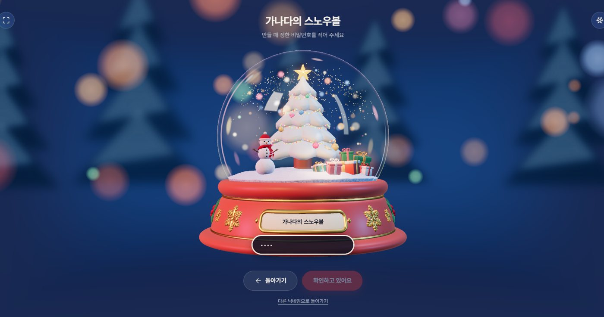
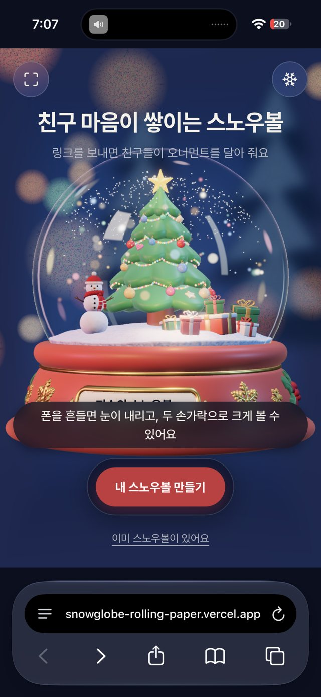
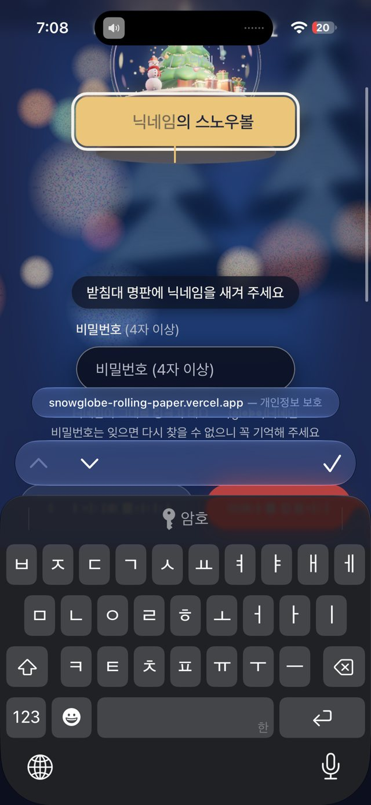
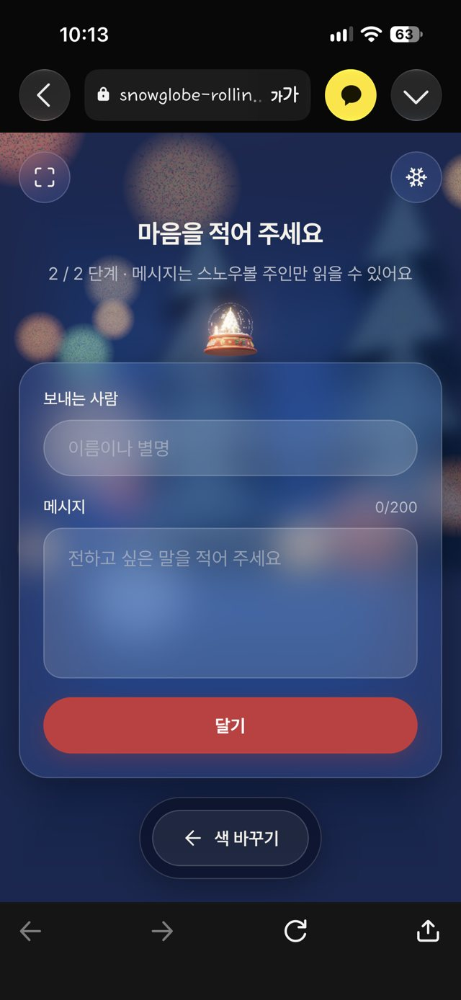
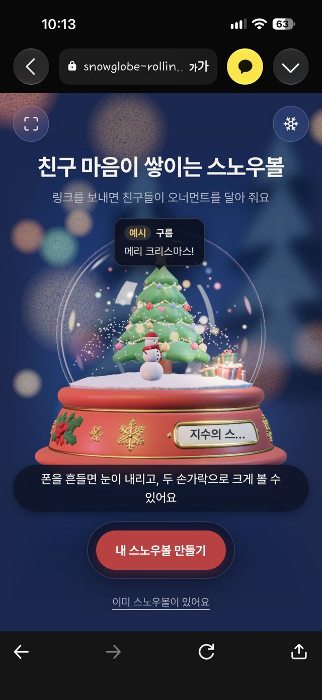
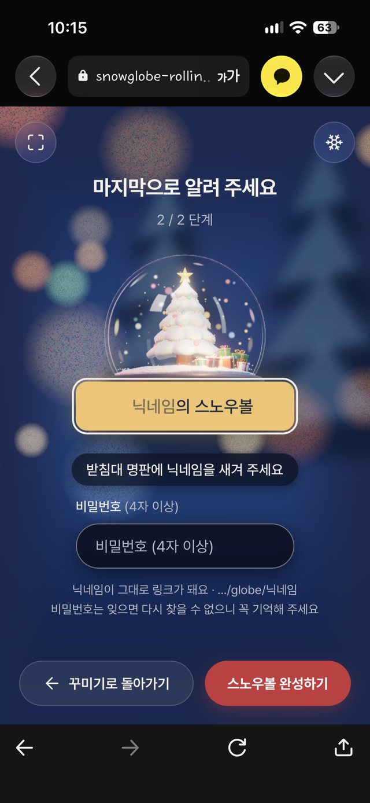
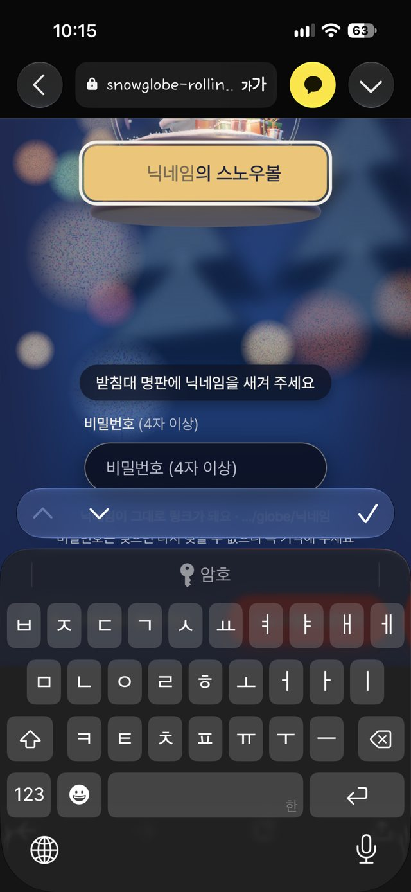

# FEEDBACK.md — 1차 피드백 정리

> 정리일: 2026-11-26 · 대상: 배포 주소 https://snowglobe-rolling-paper.vercel.app
> 작업 마감: **11/29(일) 23:59**. 전부 고치기보다 우선순위가 높은 것부터 처리합니다.

## 이 문서를 쓰는 법

- 피드백 원문은 두 곳에서 왔습니다. 같은 내용은 하나로 묶고, 어디서 나온 말인지 **출처**에 적었습니다.
  - **목록**: 팀에서 모은 1차 피드백 목록 (공통 / 웹 / 모바일)
  - **노션**: 노션 「2차 프로젝트 피드백」 페이지 (스크린샷 7장 포함)
  - **설문**: 캠프 동기 15명의 설문 결과(`docs/설문결과/요약.md`)와, 그것을 보고 11/26 에 팀이 나눈 의견. 6번 묶음에 따로 모았습니다.
- **우선순위**와 **담당**은 정리하면서 붙인 **제안**입니다. 회의에서 바꿉니다.
- 차명근이 다른 사람과 함께 담당으로 적혀 있던 항목(A1, A3, A7, A8)은 **일단 차명근이 맡습니다.** 화면이나 모델을 고쳐야 하는 부분이 나오면 이슈로 요청합니다. 다만 **A3 는 이민정이 맡습니다**(11/26 변경). 아이폰에서 직접 확인해야 하는데 차명근에게 아이폰이 없어서입니다.
- 처리하면 **상태** 칸을 바꾸고 PR 번호를 적습니다. 이 표가 그대로 "개선 전 → 개선 후" 기록이 됩니다.

| 우선순위 | 뜻 |
| --- | --- |
| P1 | 진행이 막히거나 화면이 깨져서 쓸 수 없음. 마감 전에 반드시 |
| P2 | 쓸 수는 있지만 헷갈리거나 어색함. 가능하면 마감 전에 |
| P3 | 다듬기. 시간이 남으면 |
| 아이디어 | 새 기능 제안. 이번 범위에 넣을지 먼저 결정 |

상태: ⬜ 아직 · 🔧 작업 중 · ✅ 완료 · ➖ 안 하기로 함

---

## 1. 막히거나 깨지는 것

| # | 내용 | 기기 | 출처 | 우선 | 담당(제안) | 상태 |
| --- | --- | --- | --- | --- | --- | --- |
| A1 | 친구 화면의 "이 스노우볼의 주인이에요"로 들어가 비밀번호를 넣으면 "확인하고 있어요"에서 넘어가지 않음 ([그림 1](#그림-1)) | 웹 | 노션 | P1 | 차명근 | ✅ 차명근 · PR #30 |
| A2 | 닉네임 · 비밀번호 입력란을 누르면(키보드가 올라오면) 스노우볼이 위로 밀려 받침대 10~15%만 보임. 메시지 입력 화면도 같음 ([그림 3](#그림-3), [그림 7](#그림-7)) | 모바일 | 목록(모바일 2, 6) · 노션 | P1 | 김미영 | ✅ 김미영 · PR #29 · #44 |
| A3 | 아이폰에서 폰을 흔들어도 눈이 내리지 않음 | 모바일 | 목록(모바일 1) | P1 | 이민정 | ✅ 차명근 · PR #39 (아이폰에서 권한 창이 뜨고 흔들면 눈이 내리는 것 확인) |
| A4 | 안내 문구가 서로 겹치거나 스노우볼을 가림 | 웹 · 모바일 | 아래 세부 | P1 | 김미영 | ✅ 김미영 · PR #44 |
| A5 | 닉네임 입력란의 글자가 오른쪽에서 잘림 | 모바일 | 목록(모바일 3) | P2 | 김미영 | ✅ 김미영 · PR #29 |
| A6 | 친구가 오너먼트를 두 개 달면 마지막에 단 것에만 "내 오너먼트" 안내가 붙음 | 웹 | 목록(웹 9) | P2 | 김미영 | ✅ 김미영 · PR #58 |
| A7 | 카카오톡에 보낸 카드의 이미지에서 제목이 잘림. 제목을 줄여 이미지를 다시 만들어야 함 | 공통 | 목록(웹 4) · 노션("카톡 썸네일 바꾸기") | P2 | 차명근 | ✅ 차명근 · PR #28 |
| A8 | 첫 화면이 뜨는 데 오래 걸림 | 모바일 | 노션 | P2 | 차명근 | ✅ 차명근 · PR #31 |

**A4 세부** (같은 원인으로 보이는 겹침들)
- 내 스노우볼 보기에서 링크를 복사하면 "링크를 복사했어요"가 "링크를 보내 친구를 불러 보세요"와 겹침 — 목록(웹 6), 모바일에서도 같음(모바일 5)
- 첫 화면에서 예시 메시지 말풍선과 안내 문구가 스노우볼 위에 겹쳐 뜸 — 노션("캡쳐한 이상한 화면") ([그림 5](#그림-5))
- "폰을 흔들면 눈이 내리고, 두 손가락으로 크게 볼 수 있어요" 문구가 받침대를 가리고, 스노우볼을 확대하면 더 가려짐. 문구를 바꾸고 창의 투명도 조절 필요 — 노션 ([그림 2](#그림-2))

## 2. 헷갈리는 것

| # | 내용 | 기기 | 출처 | 우선 | 담당(제안) | 상태 |
| --- | --- | --- | --- | --- | --- | --- |
| B1 | 오너먼트를 달기 전에도 기본 오너먼트가 달려 있어서, 친구가 단 것과 구별이 안 됨. **기본 오너먼트를 빼고 친구가 써 주면 달리게** 하자는 제안 | 공통 | 목록(공통 1) · 노션 | P1 | 이민정 | ✅ 이민정 · PR #36 |
| B2 | 받침대 명판이 닉네임 입력란인지 알아채지 못함. 만들기 화면과 내 스노우볼 들어가기 화면 모두 ([그림 6](#그림-6)) | 웹 | 목록(웹 2, 10) | P1 | 김미영 | ✅ 김미영 · PR #29 |
| B3 | 꾸미기의 "다음" 버튼이 다음 꾸미기 항목으로 넘어가는 버튼처럼 보임. 다 고른 뒤 누르는 "완료" 버튼으로 | 모바일 | 노션 | P2 | 김미영 | ✅ 김미영 · PR #44 |
| B4 | 스노우볼 이름 명판과 보는 방향이 같아야 함 (돌려 보다 보면 명판이 옆이나 뒤로 감) | 공통 | 목록(공통 2) · 노션 | P2 | 이민정 · 김미영 | ✅ 이민정 · PR #42 |
| B5 | 마음 적어 주기 화면에서 스노우볼이 너무 작아짐. 스노우볼은 배경에 그대로 두고 그 위에 창이 올라오는 편이 낫겠음 ([그림 4](#그림-4)) | 모바일 | 노션 | P2 | 김미영 | ✅ 김미영 · PR #29 · #44 |
| B6 | 스노우볼을 완성한 뒤 "내 스노우볼 보기"로 한 번 더 넘어가는 흐름이 살짝 어색함 (다른 방법은 떠오르지 않는다는 의견) | 웹 | 목록(웹 5) | P3 | 김미영 | ➖ 더 나은 흐름이 떠오르지 않아 지금 흐름을 그대로 두기로 함 (김미영) |

## 3. 문구와 배치

| # | 내용 | 기기 | 출처 | 우선 | 담당(제안) | 상태 |
| --- | --- | --- | --- | --- | --- | --- |
| C1 | 친구 흐름의 마지막 버튼 "달기" → "오너먼트 달기" | 웹 | 목록(웹 8) | P2 | 김미영 | ✅ 김미영 · PR #44 |
| C2 | "이 기기에서 나가기" 문구가 친근하지 않음 | 웹 | 목록(웹 7) | P2 | 김미영 | ✅ 김미영 · PR #52 |
| C3 | 완성 후 "링크를 복사했어요"를 다른 안내 문구와 같은 스타일로 | 웹 | 목록(웹 3) | P3 | 김미영 | ✅ 김미영 · PR #44 |
| C4 | 꾸미기의 소품에서 "둘 다"가 기본값이면 가장 왼쪽에 두기 | 웹 | 목록(웹 11) | P3 | 김미영 | ✅ 김미영 · PR #44 |
| C5 | 완성 후 아래에 보이는 링크 주소는 사용자에게 안 보여 줘도 됨 | 모바일 | 목록(모바일 4) | P3 | 김미영 | ✅ 김미영 · PR #52 |
| C6 | 모바일에서 전체 화면 버튼 빼기 | 모바일 | 노션 | P3 | 김미영 | ✅ 김미영 · PR #44 |
| C7 | 웹에서도 모바일처럼 꾸미기 선택지마다 글자를 붙이기 | 웹 | 노션 | P3 | 김미영 | ➖ 아이콘만으로도 알아볼 수 있어 그대로 두기로 함 (김미영) |

## 4. 눈과 3D

| # | 내용 | 기기 | 출처 | 우선 | 담당(제안) | 상태 |
| --- | --- | --- | --- | --- | --- | --- |
| D1 | 눈 내리는 모습이 정적임. 흔들면 스노우볼 안에서 사방으로 마구 흩어지게, 눈의 양도 더 많게 | 공통 | 목록(공통 3, 5, 6) · 노션("모션 이상") | P2 | 이민정 | ✅ 이민정 · PR #36 |
| D2 | 눈 입자를 더 크게 하거나 눈 결정 모양으로, 진짜 눈처럼 크기를 다양하게 | 웹 | 목록(웹 1) · 노션 | P2 | 이민정 | ✅ 이민정 · PR #36 |
| D3 | 확대해서 볼 때 위아래로도 움직일 수 있으면 좋겠음 | 공통 | 목록(공통 4) | P3 | 이민정 · 김미영 | ✅ 이민정 · PR #53 |

## 5. 새 기능 아이디어

넣을지부터 정합니다. 마감이 11/29 라서 대부분은 "다음 단계"로 남기는 편이 현실적입니다.

| # | 내용 | 출처 | 메모 | 상태 |
| --- | --- | --- | --- | --- |
| E1 | 오너먼트 모양과 색도 바꿔서 달 수 있게 | 노션 | 모양(볼 · 별 · 하트)과 색 6가지는 PR #21 에서 이미 들어감. 피드백 시점의 화면에 없었는지 확인 필요 | ✅ 김미영 · PR #21 (이미 들어가 있음. 볼 · 별 · 하트, 색 6가지) |
| E2 | 받침대 색 추가, 트리 색을 예쁜 색으로 골라 넣기 | 노션 | 꾸미기 값은 `lib/theme.ts` | ✅ 이민정 · PR #60 |
| E3 | 꾸미기 요소가 더 다양했으면 | 노션 | | ⬜ |
| E4 | 스노우볼을 다 만든 뒤 캡처(이미지 저장)하는 기능 | 노션 | 설문 14번의 "이미지로 저장해 공유"와 같은 요구 | ✅ 차명근 · PR #45 |
| E5 | 사운드 | 목록(공통 7) | 소리 버튼은 `Stage.tsx` 에 숨겨 둔 자리가 있음 | ✅ 차명근 · PR #37 |
| E6 | 배경을 3D 로 만들기 (가능하면) | 노션 | 모델이 이미 무거워서(4MB) A8 로딩 문제와 부딪힘 | ➖ 3D 배경 대신 그림 배경으로 바꿈 (이민정 · PR #49). 3D 로 만들면 로딩이 길어져서 하지 않기로 함 |

## 6. 설문에서 나온 개선안 (11/26)

설문 결과를 보고 세 사람이 낸 의견을 합쳤습니다. 1 ~ 5번 묶음(써 본 사람의 피드백)과 달리, **서비스의 흐름을 바꾸는 제안**입니다.

- **지금 정한 것**: 11/27 상호 테스트는 **지금 있는 것으로** 합니다. **F1 · F2 는 차명근이 맡습니다**(11/26). F3 · F4 는 테스트 결과를 보고 정합니다.
- 마감(11/29)까지 이틀이라 전부 하기는 어렵습니다. 하지 않은 것은 회고의 "다음에 한다면"에 씁니다.

| # | 내용 | 설문 근거 | 누가 말했나 | 메모 | 담당 | 상태 |
| --- | --- | --- | --- | --- | --- | --- |
| F1 | **친구에게 먼저 메시지를 보내는 흐름 추가.** 지금은 내 스노우볼을 만들어 "써 달라"고 링크를 보냄. 여기에 더해, 친구에게 기념 메시지를 먼저 보내고 → 받은 사람이 스노우볼을 만들면 → 그 메시지가 스노우볼에 모이게 함. 받은 사람이 스노우볼을 만들지 않으면 그 링크를 열어야만 볼 수 있음. 지금의 "내 스노우볼 공유"는 그대로 두고 **두 방법을 모두** 씀 | "링크를 보내 부탁하기가 민망해서 안 할 것 같다" 15명 중 7명 · "친구가 대신 만들어 주면 좋겠다" 2명 | 차명근 · 김미영 | 가장 큰 걸림돌(부탁하기 민망함)을 겨냥한 제안. 흐름과 DB 가 함께 바뀜: 받는 사람이 아직 없는 메시지를 어디에 둘지, 나중에 누구의 스노우볼로 옮길지를 정해야 함. 규모가 가장 큼 | 차명근 | ✅ 차명근 · PR #71 |
| F2 | **메시지 기본 템플릿.** 어떤 글을 적을지 고민을 줄이도록, 고를 수 있는 인삿말을 미리 준비해 둠 | "뭐라고 써야 할지 모르겠다" 15명 중 6명 (보낼 때 아쉬운 점 2위) | 차명근 · 김미영 · 이민정 (세 사람 모두) | 세 사람이 모두 낸 유일한 항목. 메시지 쓰기 화면에 누르면 채워지는 문구를 두는 정도면 규모가 작음. 달기까지 걸리는 시간(팀 지표)도 줄어듦 | 차명근 | ✅ 차명근 · PR #65 |
| F3 | **생일용 기념볼.** 스노우볼 말고 생일에 쓰는 것도 만듦. 생일 케이크 · 선물 · 초, 토핑으로 메시지 남기기, 폭죽 · 컨페티 날리기 | 최근 1년 동안 축하 메시지를 보낸 일: 생일 15명 중 15명 (1위) | 차명근 · 김미영 · 이민정 | 3D 모델을 새로 만들어야 함. 3D 담당 한 사람이 맡고, **다른 것을 다 만든 뒤 기회가 되면** 하기로 함 | (미정: 3D 담당) | ✅ 김미영 · PR #89 |
| F4 | **롤링페이퍼 목록 화면.** 기념일이 여러 개(연말, 생일 …)이니 종류를 고르는 화면이 필요함. 첫 화면에 버튼을 둘지 토글로 할지는 디자인할 때 정함 | (F3 을 하면 필요해짐) | 김미영 | F3 이 있어야 의미가 있음. F3 을 하지 않으면 필요 없음 | (미정) | ✅ 차명근 · PR #86 |

**항목 사이의 관계**
- F2 는 혼자서 할 수 있고 가장 작습니다.
- F4 는 F3 에 딸려 있습니다. F3 을 하면 F4 도 필요합니다.
- F1 은 F2 가 있으면 더 쉬워집니다(먼저 보내는 메시지를 템플릿으로 쓸 수 있음).

**PR 과 배포에 대해 나온 말**: PR 을 올려도 머지하지 않으면 배포 주소에 반영되지 않습니다. 테스트 전에 올라온 PR 은 기능이 비슷한 범위라 머지해도 괜찮다고 봤습니다.

---

## 한눈에 보기

| 묶음 | 개수 | P1 | P2 | P3 |
| --- | --- | --- | --- | --- |
| 1. 막히거나 깨지는 것 | 8 | 4 | 4 | 0 |
| 2. 헷갈리는 것 | 6 | 2 | 3 | 1 |
| 3. 문구와 배치 | 7 | 0 | 2 | 5 |
| 4. 눈과 3D | 3 | 0 | 2 | 1 |
| 5. 새 기능 아이디어 | 6 | — | — | — |
| **합계** | **30** | **6** | **11** | **7** |
| 6. 설문에서 나온 개선안 (따로 셈) | 4 | — | — | — |

**P1 여섯 개** (제안): A1 로그인 멈춤 · A2 키보드에 밀려 잘림 · A3 아이폰 흔들기 · A4 안내 문구 겹침 · B1 기본 오너먼트 구별 · B2 명판이 입력란인지 모름

여러 사람이 따로 말한 것(출처가 둘 이상): A2, A4, A7, B1, B4, D1, D2. 같은 말이 겹쳐 나온 만큼 체감이 큰 문제로 봅니다.

---

## 스크린샷 (노션 페이지에서 가져옴)

### 그림 1
**A1** — PC. 주인으로 들어가려고 비밀번호를 넣었는데 "확인하고 있어요"에서 멈춤.

### 그림 2
**A4** — 모바일 첫 화면. "폰을 흔들면 눈이 내리고, 두 손가락으로 크게 볼 수 있어요" 문구가 받침대와 명판을 덮음.

### 그림 3
**A2** — 모바일 닉네임 · 비밀번호 화면(사파리). 키보드가 올라오자 스노우볼이 위로 밀려 명판만 보임.

### 그림 4
**B5** — 모바일 마음 적어 주기 화면. 입력 카드가 화면을 차지하고 스노우볼은 아주 작게 보임.

### 그림 5
**A4** — 모바일 첫 화면(카카오톡 안에서 연 브라우저). 예시 메시지 말풍선과 안내 문구가 스노우볼 위에 함께 겹침.

### 그림 6
**B2** — 모바일 닉네임 · 비밀번호 화면(키보드 올라오기 전). 금색 명판이 닉네임 입력란.

### 그림 7
**A2** — 모바일 같은 화면(카카오톡 안에서 연 브라우저). 키보드가 올라오자 스노우볼이 거의 보이지 않음.

---

## 피드백 원문

정리하면서 빠뜨린 것이 없는지 대조할 수 있게 원문을 그대로 둡니다.

### 목록

**공통**
- 오너먼트 달기전에도 기본 오너먼트가 있는데 구별이 잘 안감
- 스노우볼 이름 명판이랑 보는 방향이 같아야 할 듯
- 스노우볼 눈내리는거 좀 더 역동적이면 좋겠다
- 확대해서 볼때 상하로도 움직일수도 있으면 좋겠다
- 흔들면 눈 내리는 기능에서 눈이 스노우볼 안에서 마구 흩어지면 좋을 듯
- 눈 내리는게 좀 정적임. 사방으로 흩어지게 하고 눈이 더 많으면 좋을 듯
- 사운드도 넣으면 좋으려나?

**웹**
1. 내리는 눈 입자가 더 크거나 눈 모양이었으면
2. 닉네임 입력란인지 인지 못하겠음
3. 스노우볼 완성 후 "링크를 복사했어요" 텍스트 다른 안내문구 스타일과 동일하게 수정
4. 카카오톡 OG images 수정(타이틀이 짤림, 타이틀 요약해서 이미지 변경해야함)
5. 스노우볼 완성 후, 또 내 스노우볼보기로, 페이지가 넘어가는게 살짝 이상해 보이기는 하지만 다른 방법이 생각이 안남
6. 내 스노우볼 보기 화면에서 링크를 복사하면 "링크를 복사했어요"가 "링크를 보내 친구를 불러보세요"랑 겹침
7. 내 스노우볼 보기 화면에서 "내 기기에서 나가기" 문구가 친근하지 않음
8. 친구 흐름에서 메시지를 입력하고 하단 CTA 버튼 "달기" 문구 수정 -> "오너먼트 달기"
9. 친구 흐름에서 오너먼트를 두개 달면, 마지막으로 달았던 오너먼트만 "내 오너먼트"라는 안내가 나옴
10. 내 스노우볼 들어가기 화면에서도 닉네임 입력란인지 인지를 잘 못하겠음
11. 스노우볼 꾸며 주세요 화면 소품 선택의 "둘다" 기본값이면 가장 좌측으로 정렬

**모바일**
1. 아이폰에서는 폰을 흔들면 눈이 내리는게 인식이 안됨
2. 모바일에서 닉네임과 비밀번호 입력하는 화면 닉네임 입력란과 비밀번호 입력란 선택하면 스노우볼이 상단으로 올라가서 스노우볼이 화면에서 15% 받침대 부분만 보이고 짤림.
3. 모바일 화면에서 닉네임 입력란에 텍스트가 우측에 짤려보임
4. 모바일에서 스노우볼이 완성되면 하단 링크가 생성되어, 보이는데 이 링크주소는 사용자에게 안보여줘도 될거 같음
5. 웹에서 겹치는 안내문구가 모바일에서도 그대로 겹쳐짐
6. 메세지 입력하는 화면에서도 보내는 사람, 메세지 입련란을 선택하면 스노우볼이 상단으로 올라가버려서 받침대 부분 10% 정도밖에 안보임.

### 노션 「2차 프로젝트 피드백」 (2026-11-26 에 읽은 내용)

**모바일 화면**
- 모바일에서 스노우볼 꾸밀때 다음 버튼이 다음 꾸미기단계로 넘어가는 버튼같음 (다 하고나서 완료버튼 누르게 바꾸기)
- 캡쳐한 이상한화면 수정 (메세지 겹쳐서 이상하게 뜸)
- 모바일에서 전체화면 버튼 빼기
- 모바일에서 첫화면 로딩 느린문제 해결해야할듯

**그외**
- 받침대 색깔 추가하기, 트리 색깔 예쁜색으로 골라서 넣기
- 오너먼트 모양+색깔도 바꿔서 달수있게
- 꾸미기 요소가 더 다양했으면 좋겠음
- 배경 3d 만들어서 넣기 (가능하면)
- 눈 내리는거 모션 이상 + 진짜 눈처럼 입자 다양하게 하기
- 스노우볼 다 만들고 나서 캡쳐하는 기능 있으면 좋겠다
- 카톡 썸네일 바꾸기
- 웹화면에서도 모바일처럼 꾸미기 옵션마다 텍스트 있으면 좋을듯
- 명판에 이름 보는 방향이 같도록 조정해서 수정
- 기본 오너먼트 그냥 빼고 친구가 써주면 오너먼트 달리는걸로 수정하기 > 기존에있는거랑 새로달린거랑 구분안가서 헷갈림
- 마음달기 에서 이 스노우볼의 주인이에요 누르면 비밀번호 확인에서 안넘어감 (그림 1)
- 모바일에서 '폰을 흔들면 눈이내리고 두손가락으로 확대하면 크게 볼 수 있어요' > 문구 변경 및 메세지 창 투명도 조절 필요할 듯. 스노우볼 확대되었을때 가려짐 (그림 2)
- 모바일에서 키보드 올라왔을때 화면 조정 필요 (그림 3)
- 마음 적어주기 화면에서 스노우볼이 너무 작아짐 이슈.. 스노우볼이 그냥 배경에 고정되어있고 그위에 창이 올라오는 게 나을듯? (그림 4)
- (설명 없이 붙은 스크린샷 3장: 그림 5, 6, 7)

### 설문 결과를 보고 나눈 의견 (2026-11-26, 6번 묶음의 원문)

**차명근** (회의 정리)
- 친구에게 기념 메시지를 먼저 보내는 게 어떨까?
- 기본적으로 자신의 스노우볼 공유 기능은 그대로 두고, 친구에게 보내는 방법 2개를 모두 활용 (받은 친구는 스노우볼을 만들어야 저장할 수 있음. 저장하지 않으면 해당 링크를 열어야만 볼 수 있음)
- 기본 메시지 템플릿을 추가해서 어떤 글을 적을지에 대한 고민을 줄여 주자.
- 생일이 축하 메시지로 가장 많이 쓰이니까 생일용 기념볼도 만들어야 하지 않을까?

**김미영**
- 흐름을 메시지 보내고 → 스노우볼 만들기 → 그 메시지를 스노우볼에 모을 수 있도록
- 메시지의 기본 템플릿이 작성되어 있어야 할 것 같음
- 생일처럼 기념일이 여러 개이니까, 롤링페이퍼 목록 화면이 필요할 것 같다 (메인 화면에 목록을 선택할 수 있도록 버튼을 만들든가, 토글 형태라든지. 그건 디자인할 때 선택해 보기로)
- 일단 있는 것으로 테스트함. PR 을 보내더라도 머지하지 않으면 반영되지 않으니까. 기능적인 측면은 비슷할 거라서 머지해도 상관없을 것 같다.
- 생일 관련을 만들 거면 3D 한 분이 잡고(기회가 된다면, 다 만들고). 나머지는 우선순위가 없으니 보고 작업하기로.

**이민정**
- 기본 템플릿 인사 필요 → 어떤 인삿말을 쓸지 선택지가 있어도 좋겠다
- 기념일 생일 추가? → 생일 케이크, 선물, 초, 토핑으로 메시지 남기기. 폭죽, 컨페티 날리기
